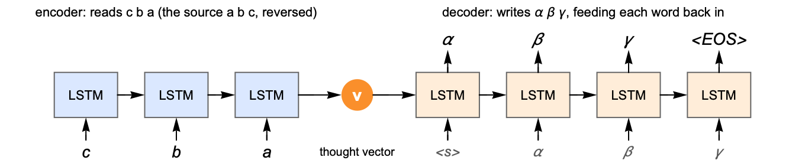
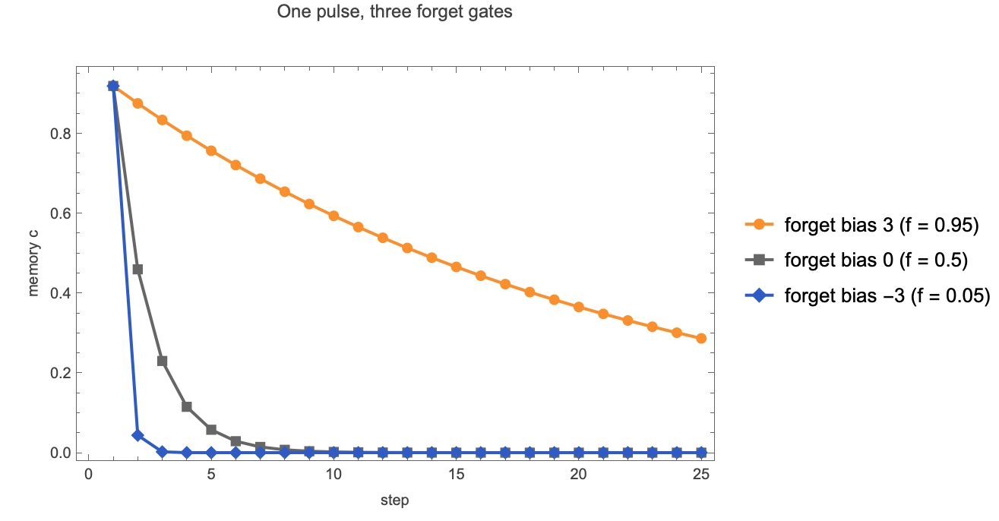
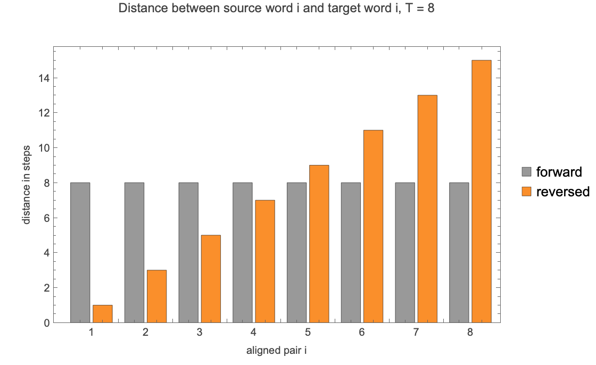
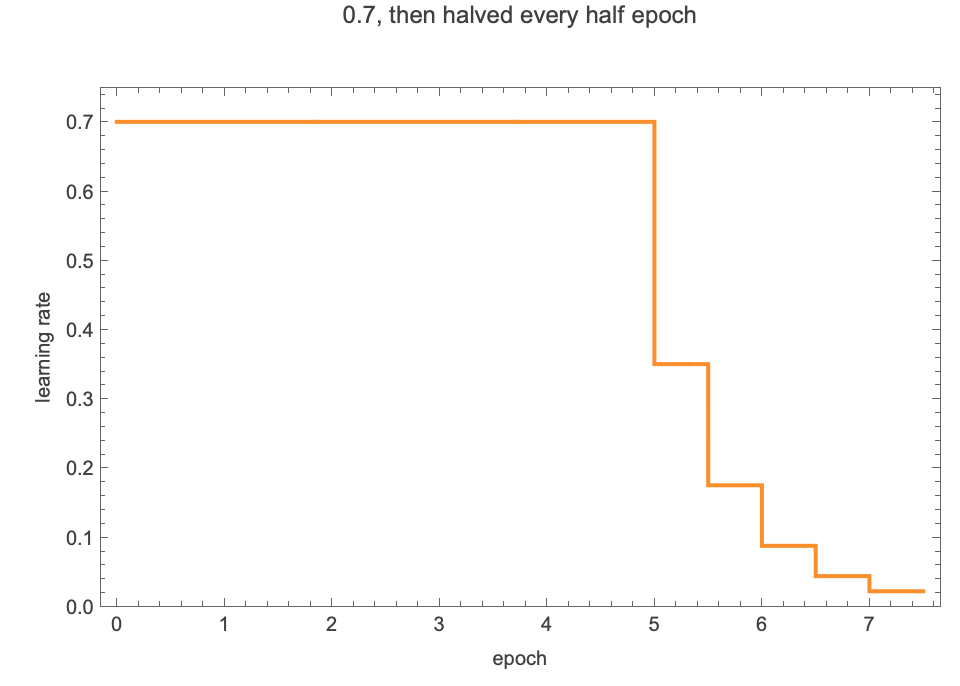
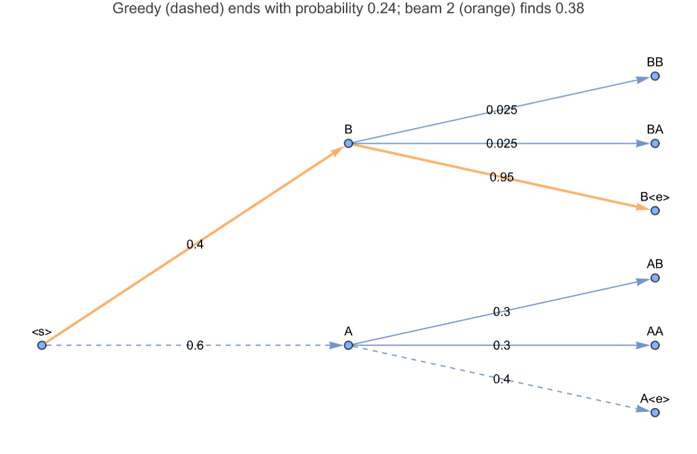

# Unit 1 · Reading a Sequence, Writing a Sequence

24 November 2026 · Computational Classnotes · TensorNets units of learning, 1 of 4

Two recurrent networks can translate. One reads the whole sentence into a fixed-size vector, and the other writes the translation from that vector. Sutskever, Vinyals and Le (2014) built this from deep LSTMs and reached 34.8 BLEU on English to French. This unit builds each part of their machine from plain arrays and checks it against Wolfram’s own layers. The notebook `unit1_seq2seq.nb` carries the same section numbers and computes every number quoted here.

## Scope and conventions

- **Vectors.** h is the hidden state an LSTM shows; c is the memory cell it keeps. σ(x) = 1/(1 + e⁻ˣ).
- **Words.** A sentence is a list of word vectors (embeddings). The decoder writes one word per step and stops at the end-of-sentence word, written `<EOS>` (or `<e>` in toy examples).
- **Numbering.** Sections 2–11 here match notebook Sections 2–11; notebook Section 1 is the toolkit, one Input cell with every function. Every number below was returned by the Wolfram kernel (Wolfram 15.0).
- **Paper.** I. Sutskever, O. Vinyals, Q. V. Le, *Sequence to Sequence Learning with Neural Networks*, NeurIPS 2014, [arXiv:1409.3215](https://arxiv.org/abs/1409.3215). Section numbers “Section n” refer to the paper; “§n” refers to this unit.
- **Repository.** https://github.com/lossofgenerality/tensor-algebra-nets · notebook `unit1_seq2seq.nb` · glossary `docs/glossary.html`.

## At a glance

**Read the reversed source into a vector, then write the target from it, one word at a time.**

**Fig. 1.** The encoder–decoder. The encoder reads the reversed source and ends in the thought vector v. The decoder starts from v and writes the target, reading back each word it has just written (§2).

## 2. Read everything, then write

A sentence and its translation rarely have the same length, and word i of one is not word i of the other. So the paper uses two networks. The **encoder** reads the source one word at a time and ends in a fixed-size vector v, the **thought vector**. The **decoder** starts from v and writes the target one word at a time, feeding each word back in, until it writes `<EOS>`:

$$
p(y_1,\dots,y_{T'}\mid x_1,\dots,x_T)=\prod_{t=1}^{T'} p\big(y_t \mid v,\,y_1,\dots,y_{t-1}\big).
$$

Three choices made it work (Section 2 of the paper): two different LSTMs for reading and writing, four layers each, and the source fed in reverse (§6).

## 3. The LSTM cell

An LSTM keeps the hidden state h and the memory cell c. At each step it reads an input x and computes four **gates** from x and the previous h:

$$
\begin{aligned}
i&=\sigma(W_i x+U_i h+b_i), & f&=\sigma(W_f x+U_f h+b_f),\\
o&=\sigma(W_o x+U_o h+b_o), & g&=\tanh(W_g x+U_g h+b_g),
\end{aligned}
\qquad
c'=f\,c+i\,g,\qquad h'=o\,\tanh(c').
$$

The input gate i decides how much new content g to write, the forget gate f how much old memory to keep, and the output gate o how much memory to show. The memory is updated by **addition**. This additive update is why information and gradients survive over long sentences.

**Worked by hand.** Take one input and one cell, every weight 0.5 and every bias 0, start from h = c = 0 and read x = 1. Every gate sees 0.5·1 + 0.5·0 + 0 = 0.5. So i = f = o = σ(0.5) = 0.6225 and g = tanh(0.5) = 0.4621. Then c′ = 0.6225·0 + 0.6225·0.4621 = 0.2877, and h′ = 0.6225·tanh(0.2877) = 0.6225·0.2800 = 0.1743.

Wolfram’s `LongShortTermMemoryLayer` stores exactly these twelve arrays (it calls g the *memory gate*). Its ports `State` and `CellState` are h and c.

The forget gate decides how long memory lasts. After a single input pulse the memory is multiplied by f at every step, so it decays like fᵗ (Fig. 2).

**Fig. 2.** The memory c of a one-cell LSTM after one input pulse, for three forget-gate biases. With f = 0.95 the pulse is still 30 % present after 25 steps; with f = 0.05 it is gone after two.

**Checked (notebook §3):** the hand computation gives h′ = 0.17427, c′ = 0.28765. Our step, copied weights and all, equals `LongShortTermMemoryLayer` (6 cells, 7 steps: True), also from given starting states (True). After the pulse the ratio of successive memories is σ(3) = 0.9526 exactly (True).

## 4. A deep encoder and its thought vector

The paper stacks four LSTMs. Layer k reads the hidden states of layer k − 1. After the last source word, the final (h, c) of every layer is kept. Together they are the thought vector: 2 × 4 × 1000 = 8000 numbers in the paper’s model.

**Checked (notebook §4):** a three-layer stack coded from arrays equals `NetChain` of three LSTM layers (True); its thought vector has 2 × 3 × 5 = 30 numbers, and the paper’s 8000.

## 5. The decoder

The decoder is a second deep LSTM with its own weights. Its layers start from the encoder’s final states. At each step it reads the embedding of the previous word, and a **softmax** turns its top hidden state into probabilities for the next word:

$$
p(\text{next word}=k)=\frac{e^{z_k}}{\sum_j e^{z_j}},\qquad z=Wh+b .
$$

**Worked by hand.** For scores z = (2, 1, 0): e² = 7.389, e¹ = 2.718 and e⁰ = 1, with total 11.107. The probabilities are 0.665, 0.245 and 0.090. They are positive and sum to 1, and adding the same number to every score changes nothing.

During training the decoder reads the correct previous word, not its own guess (**teacher forcing**). At test time it reads its own output, and beam search (§8) decides which outputs to keep.

**Checked (notebook §5):** softmax(2, 1, 0) = (0.665, 0.245, 0.090), and the same after adding 10 to every score. One decoder step gives a distribution over 10 words that is positive and sums to 1, and its first layer, started from the encoder’s states, matches Wolfram’s layer (True, True, True).

## 6. Reversing the source

The paper feeds the source reversed: c, b, a instead of a, b, c, while the target stays α, β, γ. Nothing else changes, yet test BLEU rose from 25.9 to 30.6 (Section 3.3).

The reason is distance. Put the source at positions 1…T and the target after it at T + 1…2T, with target word i aligned to source word i.

**Worked by hand (T = 3).** Forward, a, b, c sit at 1, 2, 3 and α, β, γ at 4, 5, 6, so every pair is 3 steps apart. Reversed, a sits at 3, b at 2 and c at 1, so the gaps are 4 − 3 = 1, 5 − 2 = 3 and 6 − 1 = 5. The average is 3 both ways, but the first pair is now 1 step apart. The network can link a to α at once and build from there.

**Fig. 3.** Distance between source word i and target word i for T = 8. Forward, every pair is 8 apart. Reversed, the distances are 1, 3, 5, …, 15: the same average, but the first words are neighbours.

**Checked (notebook §6):** T = 3 gives {3, 3, 3} and {1, 3, 5}; T = 8 gives averages 8 and 8, and shortest distances 8 and 1.

## 7. The training recipe

**Starting weights.** Every parameter starts uniformly distributed in [−0.08, 0.08] (Section 3.4). Wolfram’s `NetInitialize` does this with one option, but it always sets the LSTM forget-gate biases to 1. That is a later practice, recommended by Jozefowicz, Zaremba and Sutskever (2015). To follow the paper, the notebook’s `uniformInit` resets those biases too.

**Clipping the gradient by its norm.** LSTMs rarely suffer from vanishing gradients but can suffer from exploding ones. For each batch the paper computes the norm of the whole gradient, all parameters together, and rescales it if it exceeds 5:

$$
s=\lVert g\rVert_2,\qquad \text{if } s>5:\quad g\leftarrow \frac{5\,g}{s}.
$$

**Worked by hand.** g = (6, 8) has norm √(36 + 64) = 10 > 5, so it becomes (6, 8)·5/10 = (3, 4), with norm 5 and the same direction. Clamping each component to ±5 would give (5, 5) instead, which points elsewhere: its cosine with g is 70/(10·√50) = 0.990.

**The learning rate.** The paper used plain stochastic gradient descent without momentum, with batches of 128 sentences and a rate of 0.7. After 5 epochs the rate is halved every half epoch, and training stops after 7.5 epochs (Fig. 4).

**Fig. 4.** The learning rate over the 7.5 epochs of training.

**Checked (notebook §7):** plain `NetInitialize` leaves every forget-gate bias at 1.; after `uniformInit` every parameter of a two-layer LSTM is within ±0.08 (True). Clipping gives (3, 4), leaves (0.3, 0.4) alone, keeps the direction (cosine 1) where clamping does not (0.9899). The rate is 0.7, 0.35, 0.175 and 0.021875 at epochs 4.99, 5, 5.5 and 7.4.

## 8. Beam search

To write, the decoder must choose words. **Greedy decoding** takes the most likely word at each step. **Beam search** keeps the B most likely partial outputs instead. Each is extended by every word, and the B best extensions are kept. A hypothesis that ends in `<EOS>` leaves the beam and joins the finished list. The paper finds that B = 1 already works well and that B = 2 gives most of the benefit (Section 3.2).

**Worked by hand.** A toy model writes A (0.6) or B (0.4) first. After A it hesitates: A 0.3, B 0.3, `<e>` 0.4. After B it almost always stops: `<e>` 0.95. Greedy takes A, then `<e>`, so its output has probability 0.6 × 0.4 = 0.24. A beam of width 2 keeps both A and B after step 1. At step 2 the six extensions are `A<e>` 0.24, AA 0.18, AB 0.18, `B<e>` 0.38, BA 0.01 and BB 0.01. The best two are both finished, and `B<e>` wins with 0.38.

**Fig. 5.** The search tree of the toy model. Greedy follows the dashed path; the beam of width 2 also keeps B and finds the better output (orange).

**Checked (notebook §8):** greedy returns `{<s>, A, <e>}` with probability 0.24; the beam of width 2 returns `{<s>, B, <e>}` with 0.38.

## 9. How big is the paper’s model?

An LSTM layer with nᵢₙ inputs and n cells has four gates, each with an n × nᵢₙ input matrix, an n × n state matrix and n biases:

$$
\text{parameters} = 4\,(n\,n_{\text{in}} + n^2 + n).
$$

**Worked by hand.** One layer of 1000 cells reading 1000 numbers has 4 × (1 000 000 + 1 000 000 + 1000) = 8 004 000 parameters. Eight such layers make 64 032 000. The embeddings add 160 000 × 1000 + 80 000 × 1000 = 240 000 000, and the softmax adds 80 000 × 1000 + 80 000 = 80 080 000. The total is 384 112 000, the paper’s “384M parameters”. Most of them belong to the vocabulary, not to the LSTMs.

**Checked (notebook §9):** the formula equals Wolfram’s count for a layer with 4 inputs and 6 cells (True); the total is 384 112 000.

## 10. Exercises

1. Repeat the hand computation of §3 with x = −1. Which gates change, and why is h′ negative?
2. For a source of length T = 10, list the forward and reversed distances of §6 and their averages.
3. What is the learning rate at epoch 6.2?
4. How many parameters has a two-layer LSTM with 256 inputs and 512 cells per layer?
5. In the toy model of §8, change the probability of `<e>` after A from 0.4 to 0.7. Does greedy decoding still lose?

**Answers (notebook §10):** (1) every gate sees −0.5, so g = −0.4621 is negative, and c′ = −0.1745, h′ = −0.0652. (2) Forward 10 each; reversed 1, 3, …, 19; both average 10. (3) 0.0875. (4) 3 674 112, which equals Wolfram’s count. (5) No: greedy now finds `A<e>` with 0.42, which beats `B<e>` with 0.38.

## 11. Summary

Two deep LSTMs translate. One reads the whole source into the final states of its layers, and the other writes from them, one word at a time. The LSTM’s additive memory, controlled by its forget gate, carries information across the sentence. Reversing the source puts the first words next to each other. Small starting weights, norm clipping and a halving learning rate make training reliable. A narrow beam finds better outputs than greedy decoding.

Next, Unit 2 turns mathematics into sequences a machine can learn from, and Unit 3 replaces the LSTM with attention.

## Verified results

| Notebook § | Quantity | Value returned by the kernel |
|---|---|---|
| 3 | one LSTM step by hand (h′, c′) | 0.17427, 0.28765 |
| 3 | array LSTM = `LongShortTermMemoryLayer`, zero and given start | True, True |
| 3 | memory ratio after a pulse = σ(3) | True (0.9526) |
| 4 | 3-layer stack = `NetChain`; thought-vector sizes | True; 30 and 8000 |
| 5 | softmax(2, 1, 0) | 0.665, 0.245, 0.090 |
| 5 | decoder step: positive, sums to 1, matches layer | True, True, True |
| 6 | distances T = 3 forward / reversed | {3, 3, 3} / {1, 3, 5} |
| 6 | T = 8: means; shortest | 8, 8; 8, 1 |
| 7 | forget biases after `NetInitialize`; after `uniformInit` within ±0.08 | 1.; True |
| 7 | clip (6, 8); cosine after clipping / clamping | (3, 4); 1, 0.9899 |
| 7 | learning rate at 4.99, 5, 5.5, 7.4 | 0.7, 0.35, 0.175, 0.021875 |
| 8 | greedy / beam 2 on the toy model | `A<e>` 0.24 / `B<e>` 0.38 |
| 9 | parameter formula = Wolfram; paper total | True; 384 112 000 |

All 20 outputs of the notebook agree with the values above; the notebook ran with no messages.

## References

Items marked † were not opened for this unit; their links were not checked.

**The paper and its direct context**

1. I. Sutskever, O. Vinyals, Q. V. Le. Sequence to sequence learning with neural networks. NeurIPS 2014. [arXiv:1409.3215](https://arxiv.org/abs/1409.3215). The model of this unit.
2. K. Cho et al. Learning phrase representations using RNN encoder–decoder for statistical machine translation. EMNLP 2014. [arXiv:1406.1078](https://arxiv.org/abs/1406.1078). The parallel encoder–decoder proposal, with the GRU cell. †
3. D. Bahdanau, K. Cho, Y. Bengio. Neural machine translation by jointly learning to align and translate. ICLR 2015. [arXiv:1409.0473](https://arxiv.org/abs/1409.0473). Replaces the single thought vector with attention; leads to Unit 3. †

**The LSTM**

4. S. Hochreiter, J. Schmidhuber. Long short-term memory. *Neural Computation* 9(8), 1997. [doi:10.1162/neco.1997.9.8.1735](https://doi.org/10.1162/neco.1997.9.8.1735). The original cell. †
5. F. A. Gers, J. Schmidhuber, F. Cummins. Learning to forget: continual prediction with LSTM. *Neural Computation* 12(10), 2000. [doi:10.1162/089976600300015015](https://doi.org/10.1162/089976600300015015). Adds the forget gate of §3. †
6. A. Graves. Generating sequences with recurrent neural networks. 2013. [arXiv:1308.0850](https://arxiv.org/abs/1308.0850). Deep LSTMs that write sequences one step at a time. †

**Training**

7. Y. Bengio, P. Simard, P. Frasconi. Learning long-term dependencies with gradient descent is difficult. *IEEE Trans. Neural Networks* 5(2), 1994. [doi:10.1109/72.279181](https://doi.org/10.1109/72.279181). Why plain recurrent networks forget. †
8. R. Pascanu, T. Mikolov, Y. Bengio. On the difficulty of training recurrent neural networks. ICML 2013. [arXiv:1211.5063](https://arxiv.org/abs/1211.5063). Exploding gradients and clipping by the norm (§7). †
9. R. Jozefowicz, W. Zaremba, I. Sutskever. An empirical exploration of recurrent network architectures. ICML 2015. [PMLR 37](https://proceedings.mlr.press/v37/jozefowicz15.html). Recommends a forget-gate bias of 1, as Wolfram’s `NetInitialize` sets (§7). †

**Decoding and evaluation**

10. Y. Wu et al. Google’s neural machine translation system. 2016. [arXiv:1609.08144](https://arxiv.org/abs/1609.08144). Beam search with a length penalty (used in Unit 3). †
11. K. Papineni, S. Roukos, T. Ward, W.-J. Zhu. BLEU: a method for automatic evaluation of machine translation. ACL 2002. [ACL Anthology P02-1040](https://aclanthology.org/P02-1040/). The score the paper reports. †

**Wolfram Language**

12. `LongShortTermMemoryLayer`, `NetInitialize`, `NetGraph`. Wolfram Language Documentation, [reference.wolfram.com](https://reference.wolfram.com/language/ref/LongShortTermMemoryLayer.html). Layer arrays and ports used in §3–§5. †

---

© Computational Classnotes · CC BY-NC-SA 4.0
