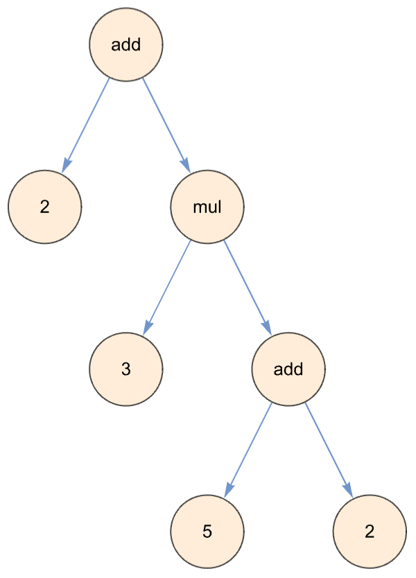
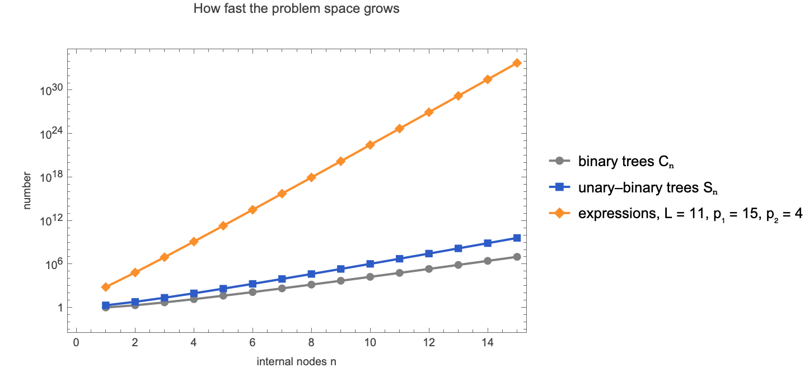
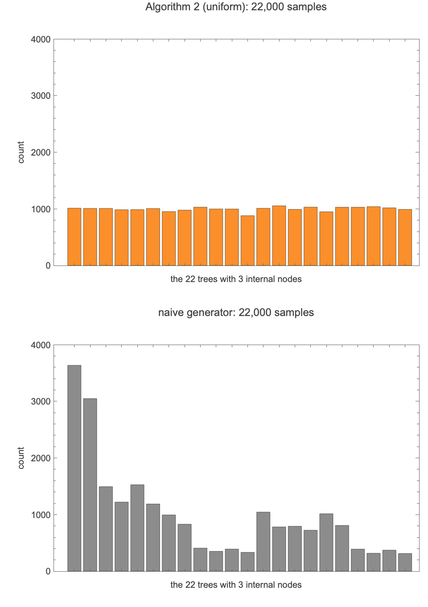

# Unit 2 · Mathematics as Data

24 November 2026 · Computational Classnotes · TensorNets units of learning, 2 of 4

A neural net can learn to integrate if integration is written as translation: the problem is one sequence and its solution is another. Lample and Charton (2019) trained a standard transformer this way, and what was new was the data. This unit builds their data machinery: trees in prefix notation, fair sampling of trees, three ways of making integration problems, and a check on every answer. Counting the trees also turns up a slip in the paper’s Equation 2. The notebook `unit2_symbolic_data.nb` has the same section numbers and computes every number quoted here.

## Scope and conventions

- **Trees.** u is a unary node, b a binary node and • a leaf. A tree is stored as its list of arities in prefix order, for example {2, 0, 1, 0} for b • u •.
- **Counts.** D(e, n) is the number of ways to complete a tree with e empty slots and n internal nodes still to place. Cₙ is the Catalan number and Sₙ the large Schröder number. L, p₁ and p₂ are the numbers of leaf values, unary operators and binary operators.
- **Variable.** In the notebook the variable is Wolfram’s formal symbol `\[FormalX]`, shown as a dotted x.
- **Numbering.** Sections 2–9 here match notebook Sections 2–9; notebook Section 1 is the toolkit. Every number below was returned by the Wolfram kernel (Wolfram 15.0).
- **Paper.** G. Lample, F. Charton, *Deep Learning for Symbolic Mathematics*, ICLR 2020, [arXiv:1912.01412](https://arxiv.org/abs/1912.01412). “Section n” and “Appendix X” refer to the paper; “§n” refers to this unit.

## At a glance

**An expression is a tree, and its prefix sequence is the tree read node first.**

**Fig. 1.** The tree of 2 + 3 × (5 + 2). Read node first, then the children from left to right, it gives the prefix sequence `add 2 mul 3 add 5 2` (§3).

## 2. Mathematics as translation

Write a problem as a sequence of symbols and its solution as another. A sequence-to-sequence model (Units 1 and 3) can then learn to map one to the other. For integration the problem is f, and the solution is a function F with F′ = f.

Three things are needed: a way to write expressions as sequences (§3), a supply of correct problem–solution pairs (§4–§6), and a way to check what the model writes (§7).

## 3. Prefix notation

Prefix (Polish) notation writes each node before its children. Every symbol has a fixed **arity**: `add`, `sub`, `mul`, `div` and `pow` take two arguments; `exp`, `log`, `sin` and `cos` take one; numbers and x take none. So prefix needs no parentheses, and trees and prefix sequences correspond one to one (Section 2.1).

**Worked by hand.** Keep a counter of subtrees still owed, starting at 1. Each symbol fills one slot and opens as many as its arity, so the counter changes by arity − 1. For `add 2 mul 3 add 5 2` it runs 1 → 2 → 1 → 2 → 1 → 2 → 1 → 0. It reaches 0 exactly at the last token, so the sequence is one complete tree. It has 7 tokens, against 9 for the infix form `2 + 3 × ( 5 + 2 )`.

A sequence is a valid tree exactly when the counter stays positive until the last token and ends at 0. An integer is a sign token followed by its digits: −305 is `INT- 3 0 5`. Ten digits and two signs cover every integer.

**Checked (notebook §3):** the counter is {1, 2, 1, 2, 1, 2, 1, 0}. `add x INT+ 3` is valid; `add x`, `add x x x` and `INT+` alone are not. −305 ↔ `INT- 3 0 5` and 12 → `INT+ 1 2`. Prefix and back returns the same expression for three examples and for all 276 well-formed random expressions of 300 drawn.

## 4. Counting trees and expressions

To sample fairly one must first count. The first empty slot of a tree is a leaf, a unary node or a binary node (Appendix C):

$$
D(0,n)=0\ (n>0),\qquad D(e,0)=1,\qquad D(e,n)=D(e-1,n)+D(e,n-1)+D(e+1,n-1).
$$

D(1, n) counts whole trees with n internal nodes. With binary nodes only, the middle term is dropped and D(1, n) = Cₙ. With unary and binary nodes it is the large Schröder number Sₙ, which satisfies the paper’s Equation 1, (n + 1)Sₙ = 3(2n − 1)Sₙ₋₁ − (n − 2)Sₙ₋₂.

**Worked by hand.** The trees with two internal nodes are u u •, u b • •, b u • •, b • u •, b b • • • and b • b • •, so S₂ = 6. By the recurrence, D(1, 2) = D(0, 2) + D(1, 1) + D(2, 1) = 0 + 2 + 4 = 6. Here D(1, 1) = 2 (u • and b • •), and D(2, 1) = D(1, 1) + D(2, 0) + D(3, 0) = 2 + 1 + 1 = 4.

**Counting expressions, and a correction.** An expression is a tree whose leaves take one of L values, unary nodes one of p₁ operators and binary nodes one of p₂. So each tree counts L^leaves p₁^unary p₂^binary times, and the total Eₙ satisfies E(z) = L + p₁zE(z) + p₂zE(z)². The paper’s Equation 2, as printed, ends in −p₁(n − 2)Eₙ₋₂. Expanding the square root gives

$$
(1-p_1z)^2-4Lp_2z \;=\; 1-2(p_1+2Lp_2)\,z+p_1^{2}z^{2},
$$

so the last coefficient is p₁², not p₁. Appendix B writes p₁z² for the last term, and the p₁ carries into Equation 2. The corrected recurrence is

$$
(n+1)E_n=(p_1+2Lp_2)(2n-1)E_{n-1}-p_1^{2}(n-2)E_{n-2},\qquad E_0=L,\quad E_1=p_1L+p_2L^2 .
$$

The two forms agree when p₁ is 0 or 1, the cases the paper checks against Equation 1 and the Catalan numbers.

**Fig. 2.** The number of binary trees, unary–binary trees and expressions with n internal nodes, on a log scale. With the paper’s 11 leaves, 15 unary and 4 binary operators there are about 5.4 × 10³³ expressions with 15 internal nodes.

**Checked (notebook §4):** the six trees, with D(1, 2) = 6, D(1, 1) = 2 and D(2, 1) = 4. D(1, n) equals Cₙ (binary) and Sₙ (unary–binary) for n ≤ 12, and the number of trees listed one by one for n ≤ 7. For L = 4, p₁ = 3, p₂ = 2 the corrected Equation 2 equals the count of every tree for n ≤ 6. The printed form agrees at n = 2 and first differs at n = 3 (19 822 against the true 19 756). With p₁ = 1 the printed form is right for n ≤ 10. For the paper’s settings, E₁₅ = 5.43 × 10³³.

## 5. Sampling trees uniformly

A naive recursive generator picks binary or unary with fixed probabilities, then splits the remaining nodes at random. It favours some shapes. The paper samples every tree with n internal nodes equally often. Start with one empty slot, e = 1, and choose the position k and arity a of the next internal node with

$$
P(k,\text{unary})=\frac{D(e-k,\,n-1)}{D(e,n)},\qquad P(k,\text{binary})=\frac{D(e-k+1,\,n-1)}{D(e,n)},\qquad k=0,\dots,e-1 .
$$

The k slots before it become leaves. Then e becomes e − k (unary) or e − k + 1 (binary), and n falls by 1 (Appendix C, Algorithm 2). With binary nodes only, the same idea is Algorithm 1.

**Worked by hand (n = 2).** With e = 1 only k = 0 is possible. P(0, unary) = D(1, 1)/D(1, 2) = 2/6 = 1/3, and P(0, binary) = D(2, 1)/D(1, 2) = 4/6 = 2/3. Of the six trees in §4, two start with u and four with b. A fair first choice is exactly the fraction of trees that start that way.

**Fig. 3.** Counts of the 22 trees with three internal nodes in 22 000 samples. The paper’s algorithm gives each about 1000. The naive generator gives the most common shape 3637 times and the rarest 314.

**Checked (notebook §5):** the first-step weights are 2 and 4 out of 6. Algorithm 2 produces all 22 trees and is consistent with uniform (χ² p-value above 0.001); the naive generator is not (p below 10⁻⁶). Algorithm 1 is uniform over the 14 binary trees with four internal nodes.

## 6. Making integration data

- **Forward (FWD).** Draw f and ask a computer algebra system for its integral. This is slow, and it only contains integrals that system can find.
- **Backward (BWD).** Draw F and differentiate it. The pair (F′, F) is always available, and it is fast.
- **Integration by parts (IBP).** If the integral of F′G is already known, the integral of FG′ follows with no computer algebra system (Section 3):

$$
\int F\,G'\,dx \;=\; F\,G-\int F'\,G\,dx .
$$

**Worked by hand.** Take F = x and G = sin x, so FG′ = x cos x. The known integral needed is ∫ sin x dx = −cos x. So ∫ x cos x dx = x sin x + cos x. Differentiating gives sin x + x cos x − sin x = x cos x.

Differentiation lengthens expressions. So in BWD data the problem is usually longer than its solution, and in FWD data the reverse. The paper notes that a model trained only on BWD data learns that integration shortens expressions, which FWD data contradicts (Section 3, Table 1).

| Method | Pairs | Mean problem length | Mean solution length |
|---|---|---|---|
| FWD | 30 | 7.07 | 12.7 |
| BWD | 60 | 8.33 | 7.13 |

**Checked (notebook §6):** every FWD and BWD pair is correct, by differentiation, and BWD problems are longer than their solutions on average (True, True, True). Three rounds of IBP over the BWD pairs of x, x², x³, sin x, cos x and eˣ found 9 new pairs, all correct, without calling `Integrate`. Among them is ±x³ sin x, whose integral, −x³ cos x + 3x² sin x + 6x cos x − 6 sin x, is the paper’s example of a solution that random generation would almost never produce.

## 7. Checking answers instead of trusting them

Nothing stops a decoder from writing an invalid prefix sequence, and such hypotheses are thrown away. An integral can be checked by differentiating it. So the paper checks every hypothesis in the beam, not only the most likely one. “Beam size 10” means that at least one of the ten hypotheses was correct (Section 4.4). A constant of integration does not matter.

**Checked (notebook §7):** for ∫ x cos x dx, the hypotheses x sin x + cos x and x sin x + cos x + 3 are accepted; x sin x and the unfinished sequence `add mul x sin` are rejected ({True, True, False, False}).

## 8. Exercises

1. Write (x + 1)² in prefix notation and run the counter of §3 over it.
2. Compute D(1, 3) from the recurrence, using D(1, 2) = 6.
3. With L = 2, p₁ = 2 and p₂ = 1, compute E₃ from the corrected and from the printed Equation 2. Which equals the count?
4. For n = 3, what is the probability that Algorithm 2 makes the root binary?
5. Use integration by parts, as in §6, to find ∫ x eˣ dx, and check it by differentiating.

**Answers (notebook §8):** (1) `pow add INT+ 1 x INT+ 2`; the counter runs 1, 2, 3, 2, 1, 0, the digits counting as part of their integer. (2) D(1, 3) = D(1, 2) + D(2, 2) = 6 + 16 = 22. (3) The corrected form gives 352, which equals the count; the printed form gives 356. (4) D(2, 2)/D(1, 3) = 16/22 = 8/11. (5) x eˣ − eˣ, whose derivative is x eˣ.

## 9. Summary

Mathematics becomes data in three steps. Expressions are written as trees in prefix notation, which is short, needs no parentheses and can be read back with a single counter. Trees are sampled uniformly by counting how many ways each choice can be completed. Correct pairs come from differentiating (BWD) and from integration by parts (IBP), with no computer algebra system. Because an answer can be checked, the model need not be trusted: every hypothesis in the beam is verified.

Next, Unit 3 builds the transformer that learns from such data, and Unit 4 uses all of this on ⨂/⨁ expressions.

## Verified results

| Notebook § | Quantity | Value returned by the kernel |
|---|---|---|
| 3 | counter for `add 2 mul 3 add 5 2` | {1, 2, 1, 2, 1, 2, 1, 0} |
| 3 | validity of four sequences | True, False, False, False |
| 3 | prefix and back: 3 examples, random expressions | True; 276 of 276 |
| 4 | D(1, 2), D(1, 1), D(2, 1) | 6, 2, 4 |
| 4 | D(1, n) = Cₙ, = Sₙ (n ≤ 12), = listed trees (n ≤ 7) | True, True, True |
| 4 | corrected Eq. 2 = count; printed form = count at n = 2, ≠ at n = 3; printed right for p₁ = 1 | True, True, True, True |
| 4 | E₁₅ for L = 11, p₁ = 15, p₂ = 4 | 5.43 × 10³³ |
| 5 | uniform sampler: all 22 trees, χ² p > 0.001; naive p < 10⁻⁶ | True, True, True |
| 5 | naive sampler: rarest and commonest counts | 314, 3637 |
| 5 | Algorithm 1 on 14 binary trees | True, True |
| 6 | FWD, BWD correct; BWD problems longer | True, True, True |
| 6 | IBP: new pairs, all correct, includes x³ sin x | 9, True, True |
| 7 | four hypotheses for ∫ x cos x | True, True, False, False |
| 8 | E₃ corrected / printed / counted (L = 2, p₁ = 2, p₂ = 1) | 352 / 356 / 352 |

All 26 outputs of the notebook agree with the values above; the notebook ran with no messages.

## References

Items marked † were not opened for this unit; their links were not checked.

**The paper and its follow-ups**

1. G. Lample, F. Charton. Deep learning for symbolic mathematics. ICLR 2020. [arXiv:1912.01412](https://arxiv.org/abs/1912.01412). The method of this unit; Equation 2 and Appendix B are corrected in §4.
2. E. Davis. The use of deep learning for symbolic integration: a review of (Lample and Charton, 2019). 2019. [arXiv:1912.05752](https://arxiv.org/abs/1912.05752). A critical reading of what the test sets measure. †
3. F. Charton, A. Hayat, G. Lample. Learning advanced mathematical computations from examples. ICLR 2021. [arXiv:2006.06462](https://arxiv.org/abs/2006.06462). The same approach for properties of differential systems. †
4. D. Saxton, E. Grefenstette, F. Hill, P. Kohli. Analysing mathematical reasoning abilities of neural models. ICLR 2019. [arXiv:1904.01557](https://arxiv.org/abs/1904.01557). A large dataset of school mathematics as sequences. †

**Counting and sampling trees**

5. OEIS A000108 (Catalan numbers) and A006318 (large Schröder numbers). [oeis.org/A000108](https://oeis.org/A000108), [oeis.org/A006318](https://oeis.org/A006318). Values and recurrences used in §4. †
6. P. Flajolet, R. Sedgewick. *Analytic Combinatorics*. Cambridge University Press, 2009. [doi:10.1017/CBO9780511801655](https://doi.org/10.1017/CBO9780511801655). Generating functions for trees, as used in §4. †
7. R. P. Stanley. *Enumerative Combinatorics*, Vol. 2. Cambridge University Press, 1999. [doi:10.1017/CBO9780511609589](https://doi.org/10.1017/CBO9780511609589). Catalan and Schröder families. †

**Symbolic integration**

8. M. Bronstein. *Symbolic Integration I: Transcendental Functions*. Springer, 2nd ed. 2005. [doi:10.1007/b138171](https://doi.org/10.1007/b138171). How computer algebra systems integrate, the FWD side of §6. †

**Wolfram Language**

9. `D`, `Integrate`, `Simplify`, `\[FormalX]`. Wolfram Language Documentation, [reference.wolfram.com](https://reference.wolfram.com/language/ref/D.html). †

---

© Computational Classnotes · CC BY-NC-SA 4.0
