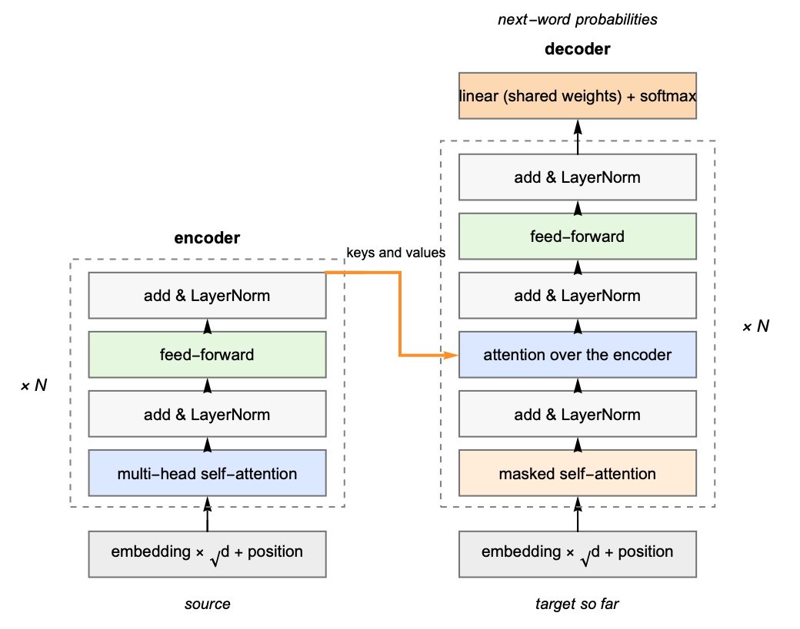
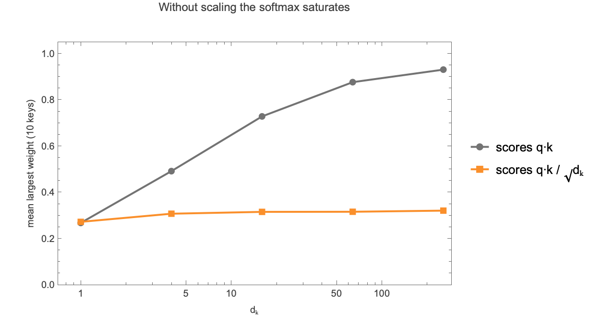
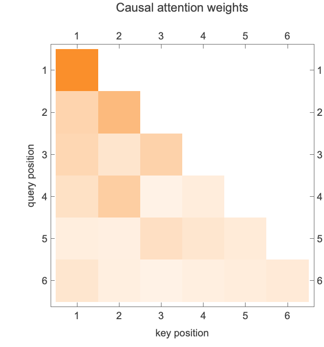
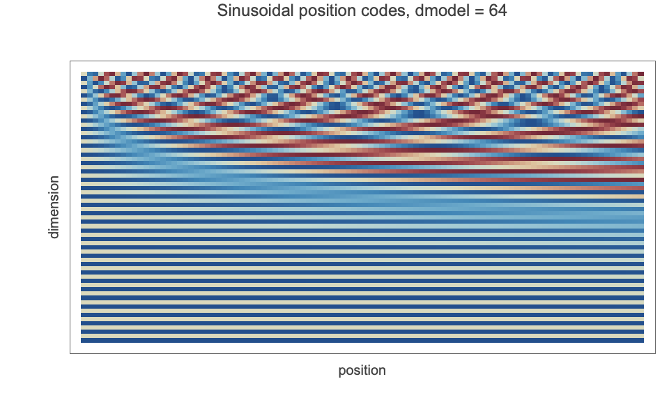
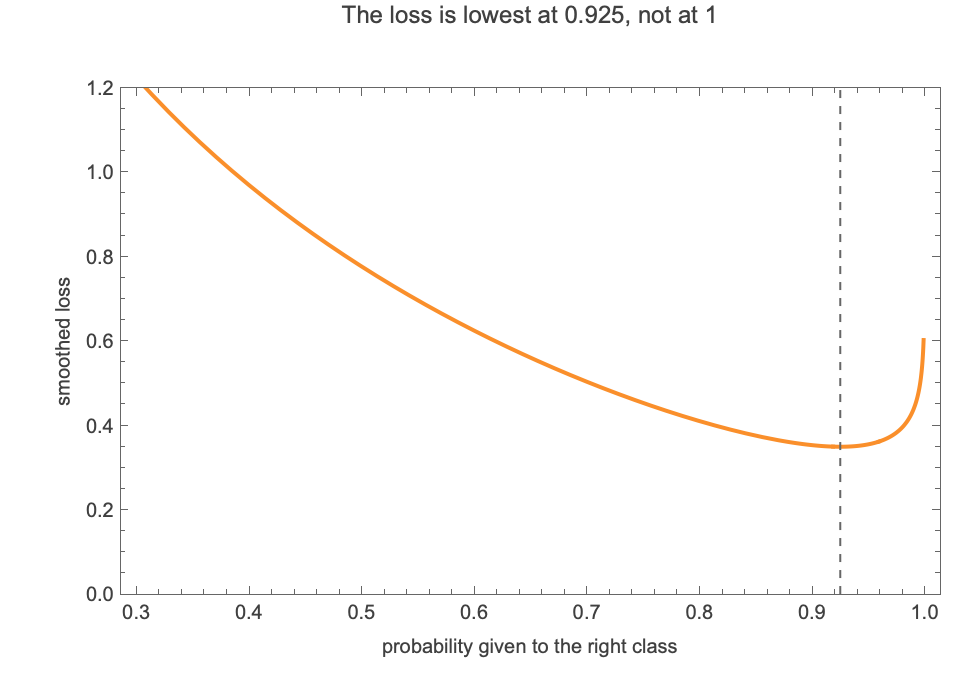
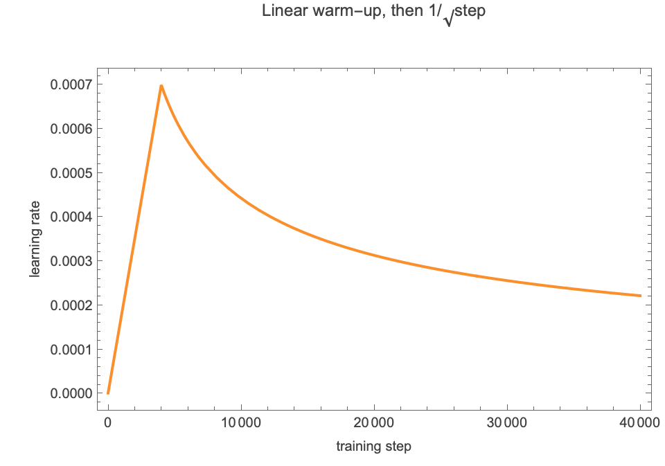

# Unit 3 · Attention, Part by Part

24 November 2026 · Computational Classnotes · TensorNets units of learning, 3 of 4

The transformer drops recurrence: every word looks at every other word at once, through attention, and word order is added as a code. Vaswani et al. (2017) built a translator from attention alone and trained it faster and better than recurrent models. This unit builds each part twice, once from plain arrays to see the mathematics and once as a Wolfram net from primitive layers to train it, and checks that the two agree. The notebook `unit3_transformer.nb` has the same section numbers and computes every number quoted here.

## Scope and conventions

- **Shapes.** A sequence is a matrix with one row per position. dmodel is the width of each row, h the number of heads, dₖ = dmodel/h, and dff the width of the feed-forward layer. The base model has dmodel = 512, h = 8, dff = 2048 and 6 encoder and 6 decoder layers.
- **Two versions.** Every part is coded from arrays (`sdpa`, `mha`, `pe`, `ffn`, `layerNorm`, `encoderLayer`, `decoderLayer`) and as a net (`mhaNet`, `peNet`, `ffnNet`, `encoderLayerNet`, `decoderLayerNet`). The array versions read their weights out of the nets, so the comparison is exact.
- **Numbering.** Sections 2–16 here match notebook Sections 2–16; notebook Section 1 is the toolkit. Every number below was returned by the Wolfram kernel (Wolfram 15.0).
- **Paper.** A. Vaswani, N. Shazeer, N. Parmar, J. Uszkoreit, L. Jones, A. N. Gomez, Ł. Kaiser, I. Polosukhin, *Attention Is All You Need*, NeurIPS 2017, [arXiv:1706.03762](https://arxiv.org/abs/1706.03762). “Section n” refers to the paper; “§n” refers to this unit.

## At a glance

**An encoder–decoder in which every layer is attention plus a small feed-forward network.**

**Fig. 1.** The transformer. Each encoder layer is self-attention, then a feed-forward network, each wrapped as add & LayerNorm. Each decoder layer adds masked self-attention and attention over the encoder’s output (orange arrow). The paper uses N = 6.

## 2. Attention instead of recurrence

An LSTM (Unit 1) reads one word after another. The first word reaches the last only through every step between them, and the steps cannot run in parallel. The transformer lets every position look at every other position directly. Each position asks a question (its **query**), every position offers a **key** and a **value**, and the output is an average of the values weighted by how well the keys match the query.

## 3. Scaled dot-product attention

Stack the queries as rows of Q, the keys as rows of K and the values as rows of V. Compare every query with every key by a dot product, divide by √dₖ (§4), take the softmax of each row and average the values with those weights (Section 3.2.1):

$$
\mathrm{Attention}(Q,K,V)=\mathrm{softmax}\!\left(\frac{QK^{\mathsf T}}{\sqrt{d_k}}\right)V .
$$

**Worked by hand.** Let q = (1, 0), with keys k₁ = (1, 0) and k₂ = (0, 1), values v₁ = (1, 0) and v₂ = (0, 1), and dₖ = 2. The scores are q·k₁/√2 = 0.7071 and q·k₂/√2 = 0. The weights are e^0.7071/(e^0.7071 + 1) = 2.028/3.028 = 0.670 and 1/3.028 = 0.330. The output is 0.670 v₁ + 0.330 v₂ = (0.670, 0.330): mostly the value of the matching key.

**Checked (notebook §3):** {{0.670, 0.330}}. The formula from arrays equals Wolfram’s `AttentionLayer["Dot", "ScoreRescaling" -> "DimensionSqrt"]` for 4 queries and 7 keys, and every row of weights sums to 1 (True, True).

## 4. Why divide by √dₖ

If the components of q and k are independent with mean 0 and variance 1, then q·k = q₁k₁ + … + q_d k_d is a sum of dₖ independent terms, each of variance 1. So Var(q·k) = dₖ and Var(q·k/√dₖ) = 1 (footnote 4 of the paper). For dₖ = 64 the unscaled scores are about ±8, the softmax is nearly one-hot, and its gradient is tiny.

**Fig. 2.** The mean largest softmax weight over 10 random keys. Without scaling it climbs towards 1 as dₖ grows; with scaling it stays near 0.3 for every dₖ.

**Checked (notebook §4):** for dₖ = 64 the measured variances are 63.6 unscaled and 0.994 scaled. The largest weight is above 0.75 unscaled and below 0.6 scaled (True, True).

## 5. Masks

A mask is added to the scores before the softmax: 0 where attention is allowed, and a very large negative number where it is not, so those weights become 0. A **padding mask** hides padding at the end of short sequences. A **causal mask** stops position i of the decoder from seeing positions after i, so it cannot read the word it must predict (Section 3.2.3).

**Worked by hand.** For three positions the causal mask is ((0, −∞, −∞), (0, 0, −∞), (0, 0, 0)). Row 1 sees only position 1, so its weights are (1, 0, 0) whatever the scores. Row 2 shares its weight between positions 1 and 2, and row 3 sees all three.

**Fig. 3.** Attention weights with a causal mask, for 6 positions. Everything above the diagonal is exactly 0.

**Checked (notebook §5):** changing positions 5 and 6 leaves outputs 1–4 unchanged; the array mask equals `AttentionLayer` with `"Mask" -> "Causal"`; with 4 real keys, changing the 2 padding keys changes nothing (True, True, True). In Wolfram, padding needs no mask: sequences of different lengths are `"Varying"` dimensions, and `NetTrain` pads and masks them itself.

## 6. Multi-head attention

One attention with dmodel-dimensional queries is replaced by h attentions of dₖ = dmodel/h dimensions each, on different learned projections. Their outputs are joined and projected once more (Section 3.2.2):

$$
\mathrm{MultiHead}(Q,K,V)=\mathrm{Concat}(\mathrm{head}_1,\dots,\mathrm{head}_h)\,W^{O},\qquad
\mathrm{head}_i=\mathrm{Attention}(QW_i^{Q},\,KW_i^{K},\,VW_i^{V}).
$$

As a Wolfram net, `mhaNet` uses `LinearLayer` for the projections (all heads at once), `ReshapeLayer` to split the dmodel features into h groups of dₖ, `AttentionLayer` with `"MultiHead" -> True` for the h attentions, `FlattenLayer` to join them and a last `LinearLayer` for W^O.

**Worked by hand.** In the base model dmodel = 512 and h = 8, so each head works in dₖ = 64 dimensions. The four projections are 512 × 512 matrices with 512 biases each: 4 × (512² + 512) = 1 050 624 parameters, whatever the number of heads.

**Checked (notebook §6):** the net from primitive layers equals multi-head attention from arrays (d = 16, h = 4), also with the causal mask. It has 4(d² + d) parameters, the same for 1 head as for 4, and 1 050 624 for the base model (True, True, True, 1050624).

## 7. Positional encoding

Attention by itself ignores word order, so a position code is added to each embedding (Section 3.5). Each pair of components is a sine and a cosine of the position, with wavelengths from 2π to 10000 · 2π:

$$
PE_{(pos,\,2i)}=\sin\!\big(pos/10000^{2i/d_{\text{model}}}\big),\qquad PE_{(pos,\,2i+1)}=\cos\!\big(pos/10000^{2i/d_{\text{model}}}\big).
$$

**Worked by hand.** Take dmodel = 4 and pos = 1. For i = 0 the frequency is 1, giving (sin 1, cos 1) = (0.8415, 0.5403). For i = 1 it is 1/10000^(2/4) = 0.01, giving (sin 0.01, cos 0.01) = (0.0100, 0.99995). Fast components tell nearby positions apart; slow ones tell distant ones apart.

**Fig. 4.** The position code of positions 0–99 (across) in 64 dimensions (down). The first dimensions oscillate fast; the last ones hardly change.

The paper chose sinusoids because, for every offset k, one fixed matrix Mₖ (a rotation in each pair of components) gives PE(pos + k) = Mₖ PE(pos) for every position. “k places later” is therefore a linear operation. In Wolfram, writing cos x = sin(x + π/2) makes every component sin(pos ω + φ): a frozen `LinearLayer` from the position, then `Sin`. That is `peNet`.

**Checked (notebook §7):** PE(1) = (0.8415, 0.5403, 0.0100, 0.99995). One rotation per offset works for k = 1, 5 and 17. PE(pos)·PE(pos + 7) is the same for every pos. `peNet` (`SequenceIndicesLayer`, a frozen `LinearLayer`, `Sin`) adds exactly these codes for any length (True, True, True).

## 8. Feed-forward, residual and LayerNorm

After attention, every position goes through the same two-layer network on its own: dmodel → dff → dmodel with a ReLU between (Section 3.3). Every sub-layer is wrapped in a residual connection and followed by layer normalisation (Section 3.1):

$$
\mathrm{FFN}(x)=\max(0,\,xW_1+b_1)\,W_2+b_2,\qquad
\text{output}=\mathrm{LayerNorm}\big(x+\mathrm{Sublayer}(x)\big),\qquad
\mathrm{LayerNorm}(v)=\gamma\,\frac{v-\bar v}{\sqrt{\operatorname{var}v+\varepsilon}}+\beta .
$$

The residual lets the signal and its gradient pass straight through. The normalisation keeps every position’s vector at mean 0 and variance 1, before a learned scale γ and shift β.

**Worked by hand.** LayerNorm of v = (1, 2, 3) with γ = 1, β = 0: the mean is 2 and the variance (1 + 0 + 1)/3 = 2/3. With ε = 0.001, √(2/3 + 0.001) = 0.8171, so the result is (−1.2238, 0, 1.2238). Without ε it would be ±1.2247.

**Checked (notebook §8):** Wolfram’s `NormalizationLayer[2, 2]` gives (−1.2238, 0, 1.2238), with ε = 0.001. `ffnNet` equals the formula at every position, and `NormalizationLayer` equals LayerNorm from arrays with a random γ and β (True, True). The paper normalises after the residual sum (post-norm). Many later transformers normalise before the sub-layer (pre-norm), which is easier to train when there are many layers.

## 9. One encoder layer and one decoder layer

An encoder layer is self-attention, then the feed-forward network, each wrapped as LayerNorm(x + Sublayer(x)). A decoder layer has three sub-layers: causal self-attention over the output so far; attention over the encoder’s output, with queries from the decoder and keys and values from the encoder; and the feed-forward network (Fig. 1).

**Checked (notebook §9):** both layer nets equal their array versions, and the decoder is causal: output i does not change when a later output position changes (True, True, True).

## 10. Shared embeddings, multiplied by √dmodel

The paper uses one weight matrix for the input embedding, the output embedding and the projection before the softmax, and multiplies the embeddings by √dmodel (Section 3.4). In Wolfram the sharing is `NetSharedArray`. `EmbeddingLayer` stores a V × d matrix, and `LinearLayer[V]` on d-dimensional inputs stores a V × d matrix too, so one array serves both.

**Checked (notebook §10):** the embedding and the output projection are one array, stored once: 20 × 8 = 160 shared weights plus 20 output biases, 180 in all (True, 180).

## 11. Label smoothing

The training target is not one-hot. With ε = 0.1 and K classes it puts 1 − ε + ε/K on the right class and ε/K on each of the others:

$$
q=(1-\varepsilon)\,\mathrm{onehot}(y)+\varepsilon/K,\qquad \text{loss}=-\sum_k q_k\log p_k .
$$

The model learns to be less sure. The paper reports that this hurts perplexity but improves accuracy and BLEU (Section 5.4).

**Worked by hand.** K = 4, right class 3, ε = 0.1: q = (0.025, 0.025, 0.925, 0.025). If the model predicts q itself, the loss is −(0.925 ln 0.925 + 3 × 0.025 ln 0.025) = 0.0721 + 0.2767 = 0.349. If it is 99.9 % sure of class 3, the three small classes alone cost 0.075 × ln 3000 = 0.601. Being too sure is now penalised.

**Fig. 5.** The label-smoothed loss for K = 4, as a function of the probability given to the right class. Its minimum is at 0.925 (dashed), not at 1.

**Checked (notebook §11):** q = (0.025, 0.025, 0.925, 0.025); losses 0.349 and 0.601.

## 12. The warm-up learning-rate schedule

Adam with β₁ = 0.9, β₂ = 0.98 and ε = 10⁻⁹. The learning rate rises linearly for the first 4000 steps, then falls as 1/√step (Section 5.3):

$$
\text{lrate}=d_{\text{model}}^{-0.5}\cdot\min\!\big(\text{step}^{-0.5},\ \text{step}\cdot\text{warmup}^{-1.5}\big),\qquad \text{warmup}=4000 .
$$

The warm-up protects the young network from large, badly aimed steps.

**Worked by hand.** The two terms are equal when step^−0.5 = step · 4000^−1.5, that is at step 4000. There the rate is 512^−0.5 × 4000^−0.5 = 0.04419 × 0.01581 = 6.99 × 10⁻⁴, the peak.

**Fig. 6.** The learning rate over the first 40 000 steps.

**Checked (notebook §12):** the peak is 0.000699, at step 4000 (True). In Wolfram the schedule is a factor of the learning rate: `NetTrain[…, Method -> {"ADAM", "Beta1" -> 0.9, "Beta2" -> 0.98, "LearningRate" -> peak, "LearningRateSchedule" -> (warmRate[#]/peak &)}]`. Unit 4 does this.

## 13. Beam search with a length penalty

Unit 1’s beam search keeps the B best partial outputs. Its scores are sums of log-probabilities, which only fall as a hypothesis grows, so plain beam search prefers short outputs. The paper uses beam size 4 and divides each finished hypothesis’s log-probability by a length penalty with α = 0.6 (Section 6.1, from Wu et al. 2016):

$$
\text{score}(Y)=\frac{\log P(Y\mid X)}{lp(Y)},\qquad lp(Y)=\left(\frac{5+|Y|}{6}\right)^{\alpha}.
$$

**Worked by hand.** Take a short hypothesis with log P = −2.0 and 2 tokens, and a long one with −2.6 and 8 tokens. Without the penalty the short one wins. With α = 0.6, lp(2) = (7/6)^0.6 = 1.097 and lp(8) = (13/6)^0.6 = 1.590. The scores become −1.823 and −1.635, and the long one wins.

**Checked (notebook §13):** {1.097, 1.590, −1.823, −1.635}.

## 14. How big is the base model?

**Worked by hand.** One attention block has 4(512² + 512) = 1 050 624 parameters. The feed-forward network has 512 × 2048 + 2048 + 2048 × 512 + 512 = 2 099 712, and one LayerNorm has 2 × 512 = 1024. So an encoder layer has 3 152 384 parameters and a decoder layer 4 204 032. Six of each make 44 138 496. The shared embedding adds 37 000 × 512 = 18 944 000, and the softmax biases 37 000. The total is 63 119 496, within 3 % of the 65M in the paper’s Table 3. The exact figure depends on the vocabulary and on what is counted.

**Checked (notebook §14):** the per-layer counts {1 050 624, 2 099 712, 1024}, the total 63 119 496, and the per-layer formulas agree with Wolfram’s counts for the small layers of §9 (True).

## 15. Exercises

1. Repeat §3 with q = (2, 0). Does the output move towards v₁ or away from it?
2. With dₖ = 16 and no scaling, what is the standard deviation of q·k?
3. Compute PE(2) for dmodel = 4.
4. With K = 10 and ε = 0.1, what probability does the smoothed target give the right class?
5. After the peak, at which step is the learning rate of §12 half its peak?

**Answers (notebook §15):** (1) (0.804, 0.196): a better match gives v₁ more weight. (2) 4. (3) (sin 2, cos 2, sin 0.02, cos 0.02) = (0.909, −0.416, 0.020, 0.9998). (4) 0.91. (5) Step 16 000, since the rate falls as 1/√step.

## 16. Summary

Attention is a weighted average, softmax(QKᵀ/√dₖ)V, where the √dₖ keeps the softmax from saturating. Masks decide who may look at whom. Several heads attend in different subspaces for the price of one. Sinusoidal codes add order in a way that makes shifts linear. Each sub-layer is wrapped as LayerNorm(x + Sublayer(x)), and encoder and decoder layers are built from these parts alone. Shared embeddings, label smoothing, warm-up and a length penalty complete the recipe. Every part built from primitive Wolfram layers equals its array version.

Next, Unit 4 assembles these nets into a transformer that expands ⨂/⨁ expressions, and trains it.

## Verified results

| Notebook § | Quantity | Value returned by the kernel |
|---|---|---|
| 3 | one query, two keys | (0.670, 0.330) |
| 3 | arrays = `AttentionLayer`; rows sum to 1 | True, True |
| 4 | Var(q·k), Var(q·k/√64) | 63.6, 0.994 |
| 4 | saturation at dₖ = 64: unscaled > 0.75, scaled < 0.6 | True, True |
| 5 | causal outputs unchanged; = `AttentionLayer` causal; padding ignored | True, True, True |
| 6 | `mhaNet` = arrays, plain and causal; parameter count; base model | True, True, True; 1 050 624 |
| 7 | PE(1) for dmodel = 4 | (0.8415, 0.5403, 0.0100, 0.99995) |
| 7 | shifts are rotations; dot product depends on distance only; `peNet` exact | True, True, True |
| 8 | LayerNorm (1, 2, 3); ε | (−1.2238, 0, 1.2238); 0.001 |
| 8 | `ffnNet` = formula; `NormalizationLayer` = LayerNorm | True, True |
| 9 | encoder layer, decoder layer = arrays; decoder causal | True, True, True |
| 10 | shared array; parameters | True; 180 |
| 11 | smoothed target; losses | (0.025, 0.025, 0.925, 0.025); 0.349, 0.601 |
| 12 | peak learning rate at step 4000 | 0.000699; True |
| 13 | lp(2), lp(8); scores | 1.097, 1.590; −1.823, −1.635 |
| 14 | per-layer counts; base total; formulas = Wolfram | 1 050 624, 2 099 712, 1024; 63 119 496; True |

All 24 outputs of the notebook agree with the values above; the notebook ran with no messages.

## References

Items marked † were not opened for this unit; their links were not checked.

**The paper and its predecessors**

1. A. Vaswani et al. Attention is all you need. NeurIPS 2017. [arXiv:1706.03762](https://arxiv.org/abs/1706.03762). The model of this unit.
2. D. Bahdanau, K. Cho, Y. Bengio. Neural machine translation by jointly learning to align and translate. ICLR 2015. [arXiv:1409.0473](https://arxiv.org/abs/1409.0473). Attention added to a recurrent encoder–decoder. †
3. M.-T. Luong, H. Pham, C. D. Manning. Effective approaches to attention-based neural machine translation. EMNLP 2015. [arXiv:1508.04025](https://arxiv.org/abs/1508.04025). Dot-product attention scores. †

**The parts**

4. K. He, X. Zhang, S. Ren, J. Sun. Deep residual learning for image recognition. CVPR 2016. [arXiv:1512.03385](https://arxiv.org/abs/1512.03385). Residual connections (§8). †
5. J. L. Ba, J. R. Kiros, G. E. Hinton. Layer normalization. 2016. [arXiv:1607.06450](https://arxiv.org/abs/1607.06450). LayerNorm (§8). †
6. R. Xiong et al. On layer normalization in the transformer architecture. ICML 2020. [arXiv:2002.04745](https://arxiv.org/abs/2002.04745). Post-norm against pre-norm, and why warm-up matters (§8, §12). †
7. O. Press, L. Wolf. Using the output embedding to improve language models. EACL 2017. [arXiv:1608.05859](https://arxiv.org/abs/1608.05859). Shared input and output embeddings (§10). †
8. C. Szegedy, V. Vanhoucke, S. Ioffe, J. Shlens, Z. Wojna. Rethinking the Inception architecture for computer vision. CVPR 2016. [arXiv:1512.00567](https://arxiv.org/abs/1512.00567). Label smoothing (§11). †
9. D. P. Kingma, J. Ba. Adam: a method for stochastic optimization. ICLR 2015. [arXiv:1412.6980](https://arxiv.org/abs/1412.6980). The optimiser of §12. †

**Decoding**

10. Y. Wu et al. Google’s neural machine translation system. 2016. [arXiv:1609.08144](https://arxiv.org/abs/1609.08144). The length penalty of §13. †

**Wolfram Language**

11. `AttentionLayer`, `NormalizationLayer`, `NetSharedArray`, `SequenceIndicesLayer`, `NetTrain`. Wolfram Language Documentation, [reference.wolfram.com](https://reference.wolfram.com/language/ref/AttentionLayer.html). †

---

© Computational Classnotes · CC BY-NC-SA 4.0
