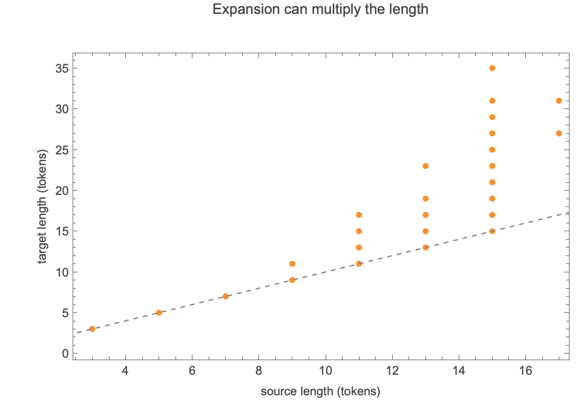
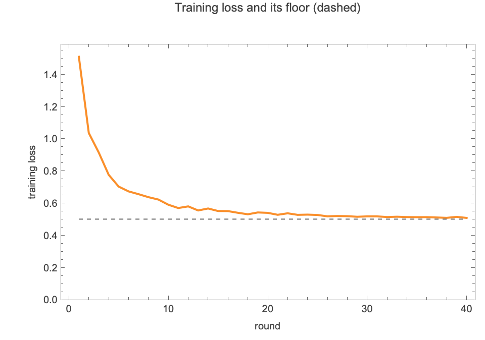
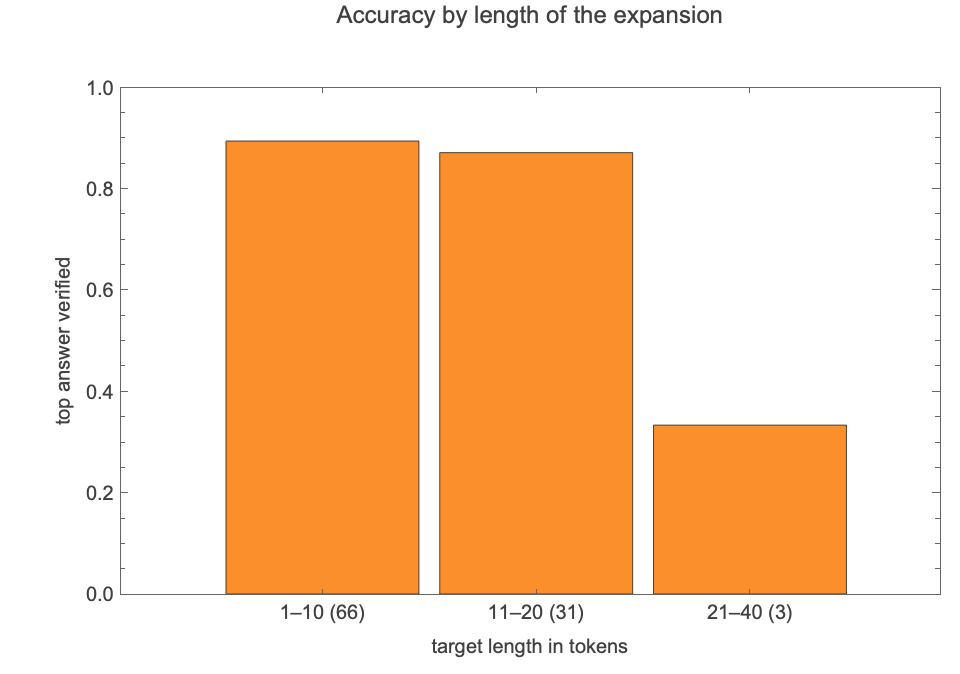

# Unit 4 · Building Our Own Net

24 November 2026 · Computational Classnotes · TensorNets units of learning, 4 of 4

This unit puts Units 1–3 to work on our own problem: given an expression such as (a⨁b)⨂c, write its expansion a⨂c ⨁ b⨂c. The data come from Unit 2, the net from Unit 3 and the decoding from Units 1 and 3. A net with 59 950 numbers, trained for under four minutes on a laptop CPU, writes the exact expansion for 87 of 100 unseen expressions. With a beam of four and an exact checker, 97 of the 100 are solved. The notebook `unit4_build_your_own.nb` has the same section numbers and computes every number quoted here.

## Scope and conventions

- **Expressions.** Atoms a, b, c, d; ⨂ is the tensor product and ⨁ the direct sum. ⨂ binds tighter than ⨁ and distributes over it on both sides. ⨂ is not commutative.
- **Words.** A word is an ordered ⨂-product of atoms. An expanded expression is a ⨁ of words.
- **Tokens.** The net reads infix tokens and writes prefix tokens (Unit 2) from one vocabulary of 10: `<s>`, `</s>`, a, b, c, d, ⨂, ⨁, (, ).
- **Numbering.** Sections 2–11 here match notebook Sections 2–11; notebook Section 1 is the toolkit. Every number below was returned by the Wolfram kernel (Wolfram 15.0, CPU).
- **Trained net.** `unit4_build_your_own_nets.nb` holds it as `ownNet = Uncompress["…"]`.

## At a glance

**Expansion can multiply the length of an expression, which makes the task harder than copying.**

**Fig. 1.** Source and target lengths in tokens for 3000 random pairs. Each point is a length pair that occurs. Above the dashed line the expansion is longer than the expression (28.8 % of pairs).

## 2. The task: expand

⨂ distributes over ⨁ on both sides:

$$
(A\oplus B)\otimes C=A\otimes C\ \oplus\ B\otimes C,\qquad A\otimes(B\oplus C)=A\otimes B\ \oplus\ A\otimes C .
$$

Expanding writes an expression as a ⨁ of words. The source is the expression as one would type it, and the target is the expansion in prefix notation. Each ⨂ of two sums multiplies the number of words, so the target can be much longer than the source (Fig. 1).

**Checked (notebook §2):** 28.8 % of 3000 random pairs have a target longer than the source.

## 3. The data

Trees are drawn uniformly with Algorithm 1 of Unit 2: 1 to 5 operators, each ⨂ or ⨁, over the atoms a, b, c and d. Because ⨂ binds tighter than ⨁, the source needs parentheses only around a ⨁ that sits under a ⨂. Pairs with a source over 25 tokens or a target over 40 are dropped.

**Worked by hand.** The tree ⨂(⨁(a, b), c) is `⨂ ⨁ a b c` in prefix. In infix its left child is a ⨁ under a ⨂, so it is bracketed: `( a ⨁ b ) ⨂ c`, 7 tokens. The tree ⨁(a, ⨂(b, c)) needs no brackets: `a ⨁ b ⨂ c`, 5 tokens.

**Checked (notebook §3):** the two infix forms are as above. The sampler reaches all 14 binary trees with four operators, each between 944 and 1046 times in 14 000 samples.

## 4. The oracle

An expression is a list of words. ⨁ joins two lists; ⨂ multiplies every word on the left by every word on the right, keeping their order:

$$
\mathrm{words}(x)=\{x\},\qquad \mathrm{words}(A\oplus B)=\mathrm{words}(A)\cup\mathrm{words}(B),\qquad
\mathrm{words}(A\otimes B)=\{\,uv : u\in\mathrm{words}(A),\ v\in\mathrm{words}(B)\,\}.
$$

Two expressions are equal when their lists of words agree up to order. This is the check `tnEquivalentQ` makes in TensorNets, here called `equivalentQ`.

**Worked by hand.** For (a⨁b)⨂(c⨁d), words(a⨁b) = {a, b} and words(c⨁d) = {c, d}. Their product is {ac, ad, bc, bd}: four words of two atoms each. In prefix, as a right-nested sum of right-nested products, it is `⨁ ⨂ a c ⨁ ⨂ a d ⨁ ⨂ b c ⨂ b d`: 15 tokens from a source of 11.

**Checked (notebook §4):** the words and the 15 tokens above. a⨂c ⨁ b⨂c is accepted in either order, and c⨂a ⨁ c⨂b is rejected because the order of factors matters. For 500 random pairs the target is equivalent to the source (True, False, True).

## 5. The net, assembled from Unit 3

This is the encoder–decoder of Unit 3, made small: d = 32, 4 heads, dff = 128, and 2 encoder and 2 decoder layers. Source and target share one vocabulary, so one array (`NetSharedArray["W"]`) serves the encoder embedding, the decoder embedding and the output projection. The decoder reads the target without its last token and predicts it without its first (teacher forcing). A frozen `EmbeddingLayer`, whose rows are the smoothed targets, turns each target index into the label-smoothed distribution (ε = 0.1). The loss is the cross-entropy against it.

**Worked by hand.** By the formulas of Unit 3, with d = 32 and dff = 128: attention 4(32² + 32) = 4224; feed-forward 32·128 + 128 + 128·32 + 32 = 8352; LayerNorm 64. So an encoder layer has 12 704 numbers and a decoder layer 16 992, and two of each make 59 392. The shared embedding adds 320 and the output biases 10. The frozen arrays add 100 (smoothing) and 128 (the two position layers). The total is 59 950.

**Checked (notebook §5):** 59 950 arrays, and one shared array for the three embeddings (True).

## 6. Training

There are 12 000 training pairs and 100 test pairs, and no test source appears in the training set. Training uses Adam with β₂ = 0.98, the warm-up schedule of Unit 3 with 400 warm-up steps, batches of 64 and 40 rounds.

**Fig. 2.** The training loss per round. It cannot reach 0: with label smoothing its floor is the entropy of the smoothed target (dashed).

**Worked by hand.** With 10 tokens and ε = 0.1, the smoothed target gives 0.91 to the right token and 0.01 to each of the others. Its entropy is −(0.91 ln 0.91 + 9 × 0.01 ln 0.01) = 0.0858 + 0.4145 = 0.500. A perfect model would score 0.500, not 0.

**Checked (notebook §6):** 12 000 and 100 pairs, trained in 208 s. The floor is 0.5003. The loss fell from 1.509 to 0.508, by more than half, and stays above the floor (True, True).

## 7. Decoding and checking

Each test source is decoded three ways:

- greedy, a beam of width 1;
- a beam of width 4 with the length penalty α = 0.6;
- the same beam, constrained by the prefix grammar.

The grammar uses Unit 2’s counter: `</s>` is allowed only when the tree is complete, and nothing else is allowed then. Every answer is checked by the oracle. As in Lample and Charton, “any in beam” counts a source as solved if any hypothesis in the beam passes the check.

**Worked by hand.** After `⨁ a` the counter is 1 + (2 − 1) + (0 − 1) = 1. One subtree is still owed, so `</s>` is forbidden and an atom or an operator must follow. After `⨁ a b` the counter is 0: the tree is complete, and only `</s>` is allowed.

| Decoding (100 test sources) | Valid prefix | Same tokens as the oracle | Top answer verified | Any in beam verified |
|---|---|---|---|---|
| greedy | 100 % | 86 % | 86 % | 86 % |
| beam 4, α = 0.6 | 100 % | 84 % | 84 % | 94 % |
| beam 4 + prefix grammar | 100 % | 87 % | 87 % | 97 % |

The top answer is right about 86 % of the time whichever way it is decoded. The beam adds alternatives, and the checker picks out a correct one for 97 of the 100 sources. Here every verified top answer also has the oracle’s exact token order.

**Checked (notebook §7):** the counter values {1, 0} and allowed sets above. With the grammar every answer is a valid tree, and “any in beam” is never below “top answer” (True, True, True).

## 8. Where the net goes wrong

**Fig. 3.** Top-answer accuracy (beam 4 + grammar) on the test sources, grouped by the length of the correct expansion.

| Target length | Test sources | Top answer verified |
|---|---|---|
| 1–10 tokens | 66 | 89.4 % |
| 11–20 tokens | 31 | 87.1 % |
| 21–40 tokens | 3 | 33.3 % |

A single wrong token spoils a whole expansion, so longer targets are harder. Only 3 test targets are longer than 20 tokens, so that last figure is uncertain. The notebook lists the wrong answers next to the correct expansions.

## 9. Saving the net

The trained net goes into its own notebook, `unit4_build_your_own_nets.nb`, as one Input cell `ownNet = Uncompress["…"]`. Evaluating that notebook after §1 brings the net back without training.

**Checked (notebook §9):** the saved net expands (a⨁b)⨂c to `⨁ ⨂ a c ⨂ b c`, which is a⨂c ⨁ b⨂c.

## 10. Exercises

1. Expand a⨂(b⨁c)⨂d by hand, and count its words.
2. How many words has (a⨁b)⨂(c⨁d)⨂(a⨁b)? How long is its expansion in prefix tokens?
3. What would the loss floor of §6 be with ε = 0.2?
4. Ask the net to expand an expression of your own, and check its answer with `equivalentQ`.
5. What does the grammar allow after `⨂ ⨁ a b`?

**Answers (notebook §10):** (1) {abd, acd}: two words. (2) 8 words of 3 atoms; the expansion has 8 × 5 + 7 = 47 prefix tokens, more than the 40 allowed in training, so the net has never seen one so long. (3) 0.867. (4) For a⨂(b⨁c) the net writes `⨁ ⨂ a b ⨂ a c`, which the oracle accepts. (5) One subtree (the right factor) is still owed, so an atom or an operator, but not `</s>`.

## 11. Summary

Every part came from the earlier units. Unit 2 gave the data: uniform trees, prefix targets and an exact oracle. Unit 3 gave the net, built from primitive Wolfram layers, with shared embeddings, label smoothing and warm-up. Units 1 and 3 gave the decoding: beam search with a length penalty, here constrained by the prefix grammar. The oracle makes the net safe to use, because an answer that fails the check is never accepted, and the beam gives several chances.

In TensorNets, `tnParserNet` in `ff_tensornets_new.nb` is this kind of encoder–decoder, mapping tokens to the prefix tree, and `tnPolicyNet` and `tnValueNet` reuse the encoder. There, simplification is done by the policy net choosing rewrite rules that the exact engine applies, so every step is sound. Here, the whole answer is written at once.

## Verified results

| Notebook § | Quantity | Value returned by the kernel |
|---|---|---|
| 2 | pairs with a longer target | 0.288 |
| 3 | infix forms; binary trees reached; counts | as in §3; 14; 944–1046 |
| 4 | words and expansion of (a⨁b)⨂(c⨁d) | {ac, ad, bc, bd}; 15 tokens |
| 4 | oracle: order of ⨁ free, order of ⨂ fixed; 500 pairs | True, False, True |
| 5 | arrays; one shared embedding | 59 950; True |
| 6 | pairs; training time | 12 000, 100; 208 s |
| 6 | loss floor; first and last loss; fell by half; above floor | 0.5003; 1.509, 0.508; True, True |
| 7 | counter after `⨁ a`, `⨁ a b` | 1, 0 |
| 7 | top answer: greedy / beam / beam + grammar | 86 %, 84 %, 87 % |
| 7 | any in beam: beam / beam + grammar | 94 %, 97 % |
| 8 | accuracy by target length 1–10, 11–20, 21–40 | 89.4 % (66), 87.1 % (31), 33.3 % (3) |
| 9 | saved net on (a⨁b)⨂c | `⨁ ⨂ a c ⨂ b c` |
| 10 | words of a⨂(b⨁c)⨂d; words and tokens of the triple product; floor at ε = 0.2 | {abd, acd}; 8, 47; 0.867 |

All 20 outputs of the notebook agree with the values above; the notebook ran with no messages.

## References

Items marked † were not opened for this unit; their links were not checked.

1. Unit 1 of this series and I. Sutskever, O. Vinyals, Q. V. Le, Sequence to sequence learning with neural networks, NeurIPS 2014, [arXiv:1409.3215](https://arxiv.org/abs/1409.3215). Encoder–decoder and beam search.
2. Unit 2 and G. Lample, F. Charton, Deep learning for symbolic mathematics, ICLR 2020, [arXiv:1912.01412](https://arxiv.org/abs/1912.01412). Uniform trees, prefix notation, checked answers.
3. Unit 3 and A. Vaswani et al., Attention is all you need, NeurIPS 2017, [arXiv:1706.03762](https://arxiv.org/abs/1706.03762). The net, label smoothing, warm-up, length penalty.
4. `DESIGN-tensornets.md` in this repository. The three TensorNets nets and their exact counterparts.
5. A. Polu, I. Sutskever. Generative language modeling for automated theorem proving. 2020. [arXiv:2009.03393](https://arxiv.org/abs/2009.03393). A net proposes and an exact checker verifies, as here. †
6. G. Lample et al. HyperTree proof search for neural theorem proving. NeurIPS 2022. [arXiv:2205.11491](https://arxiv.org/abs/2205.11491). A policy choosing rewrite steps checked by an exact engine, as `tnPolicyNet` does. †

---

© Computational Classnotes · CC BY-NC-SA 4.0
